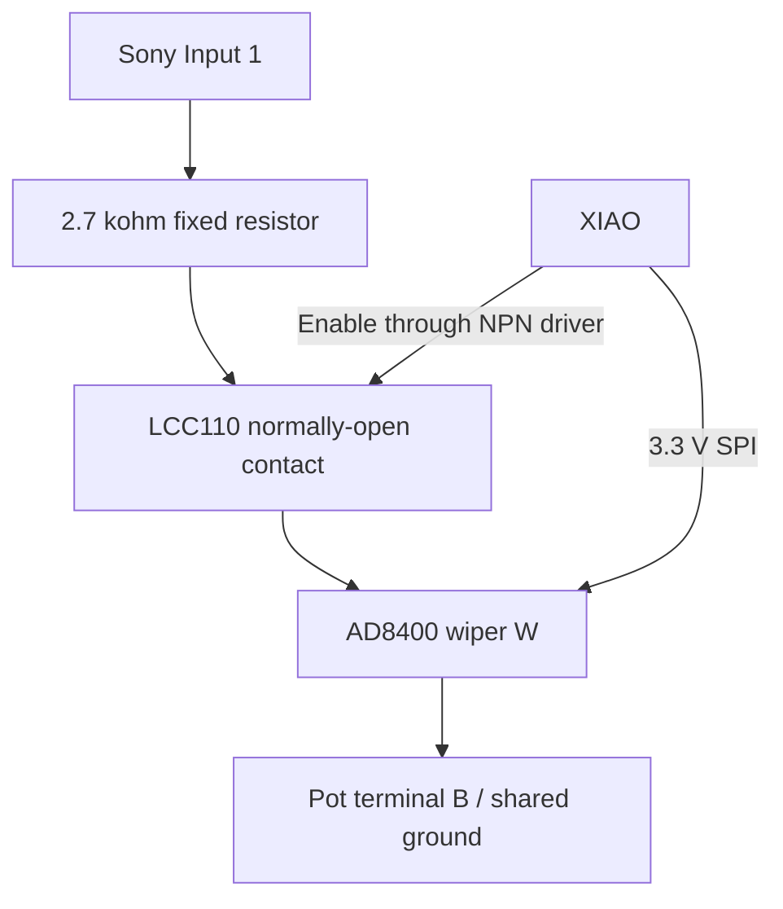

> ARCHIVED — superseded. Do not build, order parts, or assign cable contacts from this document. Use the [current design](sony-interface-ad8400.md). Statements below describe historical decisions.

# Sony interface: one LCC110 and one digital potentiometer

Design date: 2026-10-27. **The user has chosen to proceed with SOIC-8 hand soldering on an adapter**, after first practicing on an inexpensive chip. The AD8400ARZ50 is the selected prototype pot; the through-hole X9C503 alternative is not selected.

**Prototype design; no physical validation yet.** The user selected one SSR plus one digital pot. All firmware Sony/camera outputs remain disabled. This replaces the five-relay ladder and the intermediate buffered MCP4152 proposal. The [five-relay design](sony-interface-photomos.md), files now in `hardware/archive/sony-remote-photomos/`, and `scripts/sony-interface.py` are archived references, not this circuit's build instructions.

## Circuit

Input 1 connects through a fixed current-limiting resistor, the normally-open SSR contact, and the pot's variable W-to-B resistance to Sony ST Remote GND. Input 2 stays insulated. Logic GND and ST Remote GND are intentionally joined. The relay separates the signal while open; this complete system is not galvanically isolated because the pot and XIAO share ground.

**Pot: AD8400ARZ50**, 50 kohm, 256 positions, SOIC-8. It runs from regulated 5 V and accepts a 2.4 V minimum logic high, so 3.3 V commands need no level translator. Its SPI input is one-way: no MISO or shared input/output pin. This avoids the MCP41xx smart-pull-up issue that caused the previous buffer addition. It is surface mount: use a small SOIC-8-to-DIP adapter for breadboard assembly. That adapter is justified by the package and replaces the need for a separate level-shifting circuit; no carrier is added to the knob/XIAO. Exact adapter pitch, socket footprint and sourcing must be checked before purchase. A 10 kohm AD8400 is not a substitute for the 50 kohm part.

**SSR: one existing LCC110 DIP-8.** Use its normally-open pins 5/6. The internal optocoupler LED is driven from 5 V by a 2N3904; XIAO drives the transistor base, not the LED load. The transistor also gives a clean off default with a base pull-down. No flyback diode is needed for this optical input.

## Parts

| Ref | Qty | Part | Purpose |
| --- | ---: | --- | --- |
| U1 | 1 | AD8400ARZ50, 50 kohm SOIC-8 | All command resistances |
| U2 | 1 | Existing LCC110 DIP-8 | Command connect/release |
| Q1 | 1 | 2N3904, TO-92 | Relay LED driver; check manufacturer's E/B/C pinout |
| R1 | 1 | 330 ohms, 1%, 0.25 W | LCC110 LED current limiting |
| R2 | 1 | 1 kohm, 1%, axial | Q1 base current limiting |
| R3 | 1 | 2.7 kohm, 1%, axial | Fixed resistance floor/current limiting |
| RN1 | 1 | 4605X-101-473LF or equivalent: 4 x 47 kohm bussed SIP-5 | Reset pull-downs, common pin to GND |
| C1 | 1 | 100 nF ceramic, >=10 V | U1 supply bypass, next to pins 6/2 |
| Adapter | 1 | SOIC-8, 1.27 mm pitch, to 2.54 mm DIP | Breadboard/socket mounting for U1 |

The network can instead be four ordinary 47 kohm resistors for the first mock-up. Its four resistors are electrically distinct and share only ground; do not buy an isolated network or a series ladder by mistake. With the network: **two ICs, one transistor, three discrete resistors, one resistor network, one capacitor**, plus adapter/connectors/protoboard. No external buffer or second power converter. Amazon candidates are recorded in [parts sourcing](parts-sourcing-history.md); prices, live stock and delivery remain unverified. No new purchases have been reported. Follow [the SMD assembly procedure](smd-assembly.md) before using the actual pot.

## Exact nets

IC pin numbers are physical pins, top view. Verify actual package markings before wiring. Adapter header numbering must be continuity-checked; it is not automatically the IC's pin numbering.

| Device pin | Connection |
| --- | --- |
| AD8400 pin 1, B1 | Shared GND |
| AD8400 pin 2, GND | Shared GND |
| AD8400 pin 3, CS | XIAO D0/GPIO26; RN1 branch to GND |
| AD8400 pin 4, SDI | XIAO D10/GPIO3, hardware MOSI; RN1 branch to GND |
| AD8400 pin 5, CLK | XIAO D8/GPIO2, hardware SCK; RN1 branch to GND |
| AD8400 pin 6, VDD | Regulated 5 V; C1 to pin 2 |
| AD8400 pin 7, W1 | LCC110 pin 6 |
| AD8400 pin 8, A1 | Unconnected |
| LCC110 pin 2, LED anode | 5 V through R1, 330 ohms |
| LCC110 pin 3, LED cathode | Q1 collector |
| LCC110 pin 5, normally-open contact | R3, 2.7 kohm, then Sony Input 1 |
| LCC110 pin 6, normally-open contact | AD8400 pin 7 |
| LCC110 pins 7/8, normally-closed contact | Unconnected, insulated |
| LCC110 pins 1/4, package NC | Unconnected |
| Q1 emitter | Shared GND |
| Q1 base | XIAO D1/GPIO27 through R2, 1 kohm; fourth RN1 branch to GND |
| RN1 common, marked pin 1 on specified Bourns part | Shared GND |
| Sony ST Remote GND | Shared GND |
| Sony Input 2 | Individually insulated |

For the specified RN1, assign branches 2=CS, 3=CLK, 4=SDI, 5=Q1 base. A 2N3904 from another manufacturer must have its pinout checked, not assumed from the flat face.

## Controller cable

Build a fresh labeled harness: **this is incompatible with the previous six-wire ladder and eight-wire mux/buffer pinouts. Contact 2 now carries 5 V.** Mark contact 1 on both housings; actual IDC/key orientation is not established.

| Contact | XIAO | GPIO | Purpose |
| --- | --- | ---: | --- |
| 1 | GND | — | Shared GND |
| 2 | 5V / VBUS | — | Interface power |
| 3 | D8 / SCK | 2 | Pot CLK |
| 4 | D10 / MOSI | 3 | Pot SDI |
| 5 | D0 | 26 | Pot CS |
| 6 | D1 | 27 | Relay enable, through R2 |
| 7, optional | GND | — | Second ground in an eight-conductor cable |
| 8, optional | Unconnected | — | Reserve for future D6/GPIO0 camera interface |

Six conductors are sufficient; use eight if convenient. D9/GPIO4 MISO remains free. Twist stays on D4/GPIO6 SDA and D5/GPIO7 SCL with its unchanged four-wire cable. D2/D3/D6/D7 are free. Power everything from the same regulated 5 V source; never put vehicle 12 V on this harness. Start with short cable and 100 kHz SPI; test final cable length before installation.

## Component calculations and limits

Design supply envelope: **4.75–5.25 V at the board**, to be measured under load. LCC110 LED current is approximately (5 − 1.42 − 0.1)/330 = 10.5 mA. With 4.75 V, VF=1.56 V, a conservative 0.3 V transistor drop and +1% R1, it remains about 8.7 mA, above the 8 mA operate specification. With 5.25 V, VF=0.9 V and −1% R1, it is below 13.4 mA. R1 dissipates under 0.06 W at that bound. These LED data are specified at 25°C; measure actual current and verify eventual temperature behavior.

Q1 base drive is nominally about 2.5 mA through 1 kohm, with negligible diversion into 47 kohm. Use at least 4 mA RP2040 pad drive strength in the future backend. The GPIO is supplying base current; the 5 V rail supplies the optical LED. Allow 20 mA extra interface supply budget pending measurement.

R3 means even a zero-scale programming mistake leaves approximately 2.7 kohm in the signal path, bounding current from an ideal 5.25 V source to under 2 mA. It is **not** a voltage clamp or proof of safe operation at every code. AD8400 current limits depend on resistance/code as well as wiper current. Before receiver connection, measure source impedance and commanded current; a conservative prototype target is <=0.5 mA for all five commands, with code-dependent limits reviewed if exceeded. Use a 5 V pull-up through 10 kohm for initial simulated-input tests.

Analog terminal voltages must stay between GND and actual U1 VDD. Roughly 3.3–5 V sensing is a working expectation, not a Sony-published XAV-9000ES rating. Measure the Sony's open-circuit Input 1 voltage and local U1 supply before connection. The relay does not make the pot 12 V tolerant while closed.

## Commands and firmware behavior

Measure total resistance across the Sony connector with the Sony disconnected. R3 and relay/wiper resistance are included. AD8400 end-to-end resistance tolerance is ±30%, so nominal codes are starting estimates only.

| Command | Target total | Nominal starting code |
| --- | ---: | ---: |
| Mute/ATT | 4.4 kohm | 8 |
| Next | 8.8 kohm | 31 |
| Previous | 12.1 kohm | 48 |
| Volume up | 16.8 kohm | 72 |
| Volume down | 23.6 kohm | 107 |

Codes assume 50 kohm end-to-end, 50 ohm wiper, 23 ohm relay and 2.7 kohm fixed resistor. Formula: `Rtotal ≈ 2700 + Rrelay + Rwiper + 50000 * code / 256`. Store individually calibrated codes in XIAO settings later. Sony Custom learning is the fallback for small residual target differences, subject to actual recognition.

1. Startup: preload D1 LOW and D0 HIGH before output configuration. Initialize SPI mode 0, MSB-first, 100 kHz. The pulled-down Q1 base keeps the relay open while the XIAO starts/resets.
2. Ensure relay open. Select U1, send 16 bits with channel/address 00 and the 8-bit code in the low byte, then raise CS. The last ten bits are the address/data word. No return-data wire is used.
3. Allow an initial 1 ms pot-settling interval. Set D1 HIGH for 55 ms, then LOW for at least 55 ms. LCC110 switching can take 4 ms under its stated conditions; these starting timings allow roughly 50 ms effective command/release intervals. Tune on the actual Sony.
4. Implement with a nonblocking timer state machine. Keep gesture processing and LED feedback unchanged; bound/coalesce volume requests and discard stale ones rather than replaying a backlog.
5. Reset, Twist failure and failed initialization release D1 and clear queued commands. Add a watchdog when implementing the output backend so a hang is time-limited. SPI transmission provides no confirmation that a chip is present or the Sony acted.

Current firmware remains unchanged. First add a separate Sony-disconnected resistance-calibration diagnostic; only enable controller outputs after physical interface validation. No flashing or receiver power-up is performed as part of this design work.

## Power loss: acceptance boundary

At reset with valid supply, the base pull-down turns Q1 off and opens the relay. At steady power-off the normally-open contact is open. **An abrupt supply loss is not yet proven:** relay release can take milliseconds, while the pot supply can fall earlier. Momentary current could flow from Sony into the falling pot rail. A power-on/off steady DMM check cannot establish transient safety. Use a simulated Sony pull-up and observe the input/pot rail during abrupt removal and slow ramps, preferably on a scope. If it violates the pot limits, the installation needs supply hold-up/disconnect sequencing or a different protected pot. Do not represent this prototype as already solving that transition.

## Build and validation

Use existing solderless boards first. The LCC110, SOIC adapter, transistor and passives should fit the approved small protoboard, but adapter dimensions and actual routing require a dry-fit. No permanent pad map has been validated; the old generated placement is not usable.

- Unpowered: check all nets and no shorts; confirm Input 1 cannot bypass the normally-open contact. Verify adapter and Q1 physical pin numbering.
- Logic powered, Sony absent: check rails and relay LED current by measuring voltage across R1 and dividing by 330. Ensure XIAO digital nodes remain at 3.3 V logic levels.
- With no external voltage on the isolated Sony port: measure open/OL idle and each calibrated resistance while the future diagnostic closes the contact. Reset/release must restore open.
- Simulated input: <=5 V through 10 kohm; check commanded currents, voltage limits, reset and both power-loss orders. Use voltage mode on this energized test, not ohms mode.
- Actual Sony later: measure Input 1 to ST Remote GND with our circuit disconnected. A known 10 kohm test load allows estimating source resistance as `10000 * (Vopen/Vloaded - 1)` for a steady simple pull-up. Then confirm supply margin/current limits, learn commands as needed and test timing at low volume.
- Finish pad placement, connector orientation, final cable test and mounting only after the prototype passes. Camera switching remains separate.

## Primary references

- [Analog Devices AD8400/8402/8403 datasheet](https://www.analog.com/media/en/technical-documentation/data-sheets/AD8400_8402_8403.pdf), pages 6, 11–12, 20–22: 50 kohm specs, voltage/current limits, pinout and serial protocol.
- [Littelfuse LCC110 datasheet](https://www.littelfuse.com/assetdocs/littelfuse-integrated-circuits-lcc110-datasheet?assetguid=fef24721-9a57-4423-a6f7-7e12c72ec530), pages 1–2: LED and contact pins, input current and switching time.
- [onsemi 2N3903/2N3904 datasheet](https://www.onsemi.com/pdf/datasheet/2n3903-d.pdf): pinout and saturation characteristics.
- [Bourns 4600X networks](https://www.bourns.com/docs/product-datasheets/4600x.pdf): 101 bussed topology, pin 1 common, 473 value code.
- [Voltage research](sony-interface-simplification.md) and [stock Sony RM-X2S board scan/resistance table](https://llg.cubic.org/tools/sonyrm/). No third-party firmware copied.
