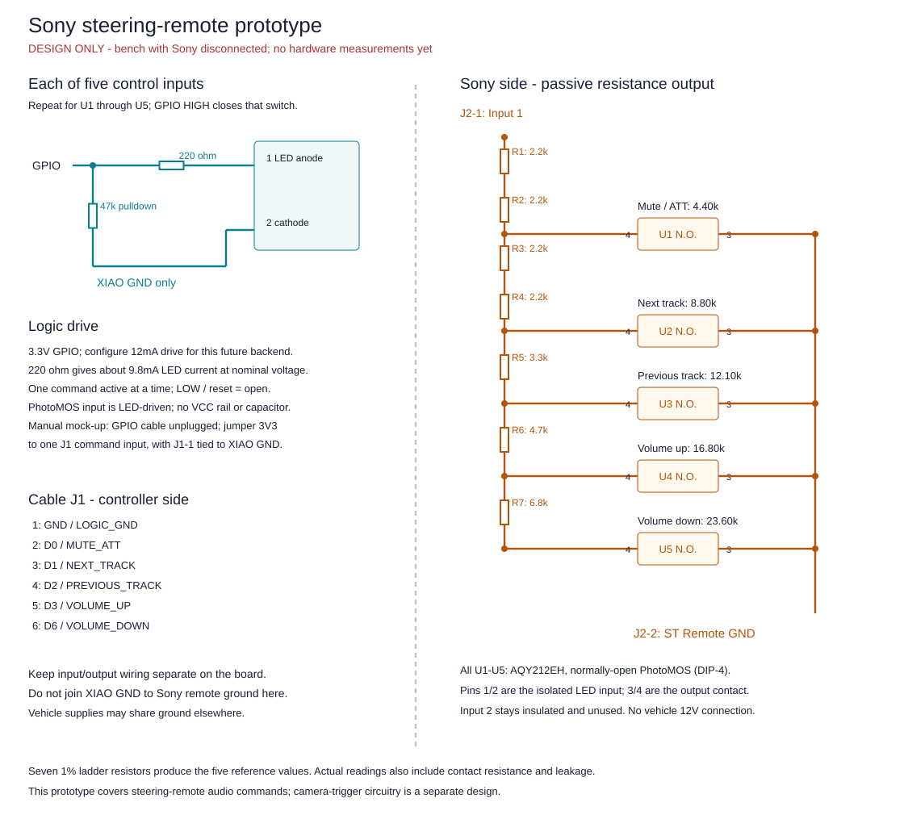
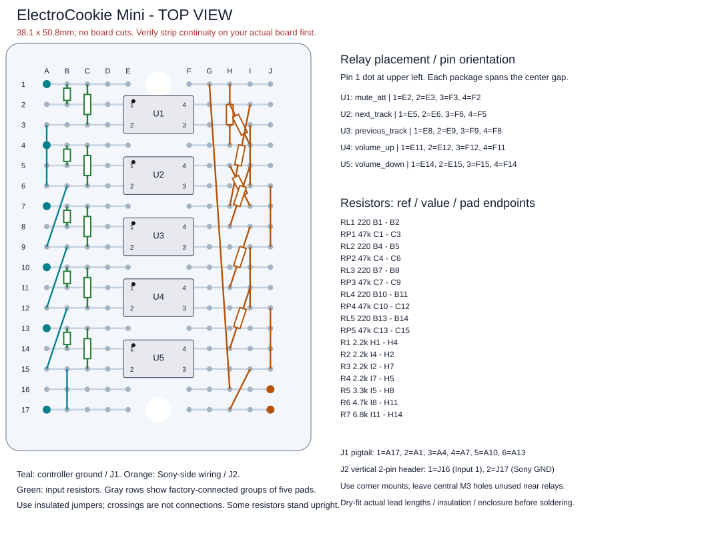

> ARCHIVED — superseded. Do not build, order parts, or assign cable contacts from this document. Use the [current design](../sony-interface.md). Statements below describe historical decisions.

> Archived design: superseded by [one SSR plus digital pot](../sony-interface.md). Its diagrams and cable assignments are not current.

# Sony steering-remote prototype

Design ready for a receiver-disconnected breadboard mock-up. Nothing in this circuit has been assembled, measured, or tested against the XAV-9000ES yet. The gesture/LED controller remains unchanged and its Sony outputs remain disabled.

## Selected circuit

Use seven fixed resistors in a series ladder and five **Panasonic AQY212EH** normally-open PhotoMOS switches, one per tap. Each switch connects its selected tap to ST Remote GND. All switches open is the released/no-command state. A PhotoMOS is a silent optically controlled semiconductor contact, not a mechanical relay or a transistor-output optocoupler.

This supersedes the earlier CD74HCT4051 proposal. It uses more switch packages, but eliminates the mux supply, analog-rail restriction, address decoding, and a powered-off path through a mux's protection diodes. The control side has no VCC pin: current comes from the selected 3.3V GPIO through an LED resistor. The Sony-side signal never connects to GPIO, 3V3, or 5V on this board. Keep logic ground and ST Remote GND separate on the board, even though vehicle power/USB grounds may connect elsewhere.

This prototype is for a low-current remote-control signal up to **16V DC magnitude**, not raw vehicle power. The PhotoMOS device rating is higher, but that is not a claim of automotive surge qualification. Panasonic's application note asks designers to consult them for automotive applications; installation temperature/transient validation remains separate from this breadboard design.

## Resistor ladder and output targets

Starting at **Input 1**, connect R1 through R7 in series. Close exactly one switch from a listed tap to ST Remote GND:

| Segment | Value, 1% | Cumulative resistance | Switch at this tap | Command |
| --- | ---: | ---: | --- | --- |
| R1 | 2.2k | 2.2k | None | Intermediate node |
| R2 | 2.2k | 4.4k | U1 | Mute/ATT |
| R3 | 2.2k | 6.6k | None | Intermediate node |
| R4 | 2.2k | 8.8k | U2 | Next track |
| R5 | 3.3k | 12.1k | U3 | Previous track |
| R6 | 4.7k | 16.8k | U4 | Volume up |
| R7 | 6.8k | 23.6k | U5 | Volume down |

These targets come from the separate RE_SWC_FW Sony implementation, not a Sony-published tolerance specification. We have not copied its code. Its 50ms assertion/50ms release timing is a candidate for later command pulses; it is not established by the DC meter tests below. Continuous holds used for measurement must never be used as an automatic command loop on the radio.

Ideal resistor-only endpoints, at 1% worst-case tolerance: 4,356–4,444; 8,712–8,888; 11,979–12,221; 16,632–16,968; 23,364–23,836 ohms. Actual switched readings also include contact resistance, off-channel leakage, temperature, and meter error. Record them rather than treating these resistor-only bands as a full circuit guarantee. With the specified LED drive at 25°C, the relay's published maximum on resistance is 2.5 ohms, small compared with the ladder.

Only one switch may be on. Multiple closures select the tap closest to Input 1 in the ideal ladder, rather than creating a valid second command. Software must enforce all-off between selections, bounded command duration, and one active output at a time.

## Switch input wiring — repeat five times

| AQY212EH pin | Connection |
| --- | --- |
| 1, LED anode | Corresponding command lead through **220 ohms**, 1% |
| 2, LED cathode | XIAO logic ground |
| 3, output contact | ST Remote GND |
| 4, output contact | Corresponding ladder tap |

Put a **47k pulldown** from each command lead to logic ground, before its 220-ohm resistor. Pin numbers refer to the manufacturer's package diagram, top view; pin 1 is upper left, pin 2 lower left, pin 3 lower right, pin 4 upper right when oriented as in the placement drawing. Confirm the pin-1 mark on the actual part.

For the eventual GPIO backend, configure **12mA pad drive**, preload each output LOW, then enable it as an output. This pad setting is drive strength, not a current regulator. Nominal LED current is `(3.3 - 1.14) / 220 = 9.8mA`. Using the RP2040's 2.62V minimum high level and the relay's 1.5V maximum LED drop gives about **5.0mA** with a +1% resistor. The 47k pulldown adds about 0.07mA nominally. One-hot operation keeps total GPIO-source current comfortably below the RP2040's 50mA aggregate limit.

Panasonic recommends at least 5mA LED drive for specified behavior. Its published turn-on/off limits are 4ms/1ms at the stated 5mA, 25°C test conditions; verify actual pulse recognition on the Sony later. No flyback diode, mux supply, or supply bypass capacitor is required for these LED-driven switches. Their output is a bidirectional semiconductor contact; an ordinary PC817/4N35/LTV-817 is not an equivalent substitute.

## Control cable — replaces the old mux pin allocation

J1 is a **six-conductor cable** between the XIAO and the board near the Sony. It carries no 5V supply. The old eight-wire mux allocation is obsolete; in particular, do not reuse its old 5V assignment on conductor 2.

| J1 contact | XIAO label | RP2040 GPIO | Switch | Purpose |
| --- | --- | ---: | --- | --- |
| 1 | GND | — | All input cathodes | Logic return only |
| 2 | D0 | 26 | U1 | Mute/ATT |
| 3 | D1 | 27 | U2 | Next track |
| 4 | D2 | 28 | U3 | Previous track |
| 5 | D3 | 29 | U4 | Volume up |
| 6 | D6 | 0 | U5 | Volume down |

A future eight-conductor cable may reserve contact 7 for D7/GPIO1 to a separate camera interface, with contact 8 spare. Leave both unconnected now. D4/GPIO6 and D5/GPIO7 remain dedicated to the Twist. D8–D10 stay free.

J2 is a separate two-contact connector:

| J2 contact | Sony adapter lead |
| --- | --- |
| 1 | Input 1 |
| 2 | ST Remote GND |

Input 2 stays insulated. The included Sony cable supplies the plug and labeled leads; no audio breakout is needed. Actual command acceptance on Input 1 remains a receiver test. Camera-trigger circuitry is not part of this resistor interface.

## Parts

[Machine-readable BOM](../../hardware/archive/sony-remote-photomos/bom.csv):

| Quantity | Part |
| ---: | --- |
| 5 | **AQY212EH**, through-hole DIP-4, normally open |
| 4 | 2.2k, 1%, axial 0.25W |
| 1 each | 3.3k, 4.7k, 6.8k, 1%, axial 0.25W |
| 5 | 220 ohm, 1%, axial 0.25W |
| 5 | 47k, 1%, axial 0.25W |
| 1 | ElectroCookie Mini 38.1 × 50.8mm, the previously selected board |
| 1 each | Removable six-contact control pigtail and two-contact Sony connector |
| As needed | Insulated 26–28AWG hookup wire, insulation, enclosure/mounting/strain relief |

DIP sockets are optional and add height. Parts marked **EHA/EHAX** have different lead forms; buy the exact through-hole **AQY212EH** for this plan. No part has been purchased or substituted by the agent.

[Amazon US sourcing links and exact quantities](../parts-sourcing.md): two ten-pack listings advertise AQY212EH DIP-4, and a verified-value-list resistor assortment covers the BOM. Live relay price/delivery could not be confirmed; the advertised part/package match is not independent verification of the shipped components. The user has four LCC110 devices but chose to retain this original design.

## Permanent-board placement, without cutting

The layout uses all five relays across the board's center gap. **A–E within each numbered row are connected; F–J within that row are connected separately.** There are no connections across the gap unless a component/wire provides one. Our placement is derived from the product's top/bottom routing image; confirm it with continuity on the actual board before assembly. No board or track cuts are planned.

The exact pads for every component and jumper are in [prototype.json](../../hardware/archive/sony-remote-photomos/prototype.json) and the placement drawing. The five packages occupy E/F row pairs 2/3, 5/6, 8/9, 11/12, 14/15, with inputs on the A–E side. Stand RL1–RL5, RP1–RP5, and R1–R4 upright and insulate their folded leads. R5–R7 may lie flat only if the actual body/lead bends fit; otherwise stand them too. The drawing shows electrical pad endpoints rather than flat component bodies. The 38.1 × 50.8mm figure is board area, not assembled height. Dry-fit actual package/socket/lead lengths before soldering. Use corner mounting holes; the central M3 holes are too close to the relay bodies for mounting screws in this layout.

J1 uses a removable pigtail landing at A17 (logic ground), A1 (mute), A4 (next), A7 (previous), A10 (volume up), A13 (volume down); these are not one adjacent six-pin board header. This avoids another board or custom crimp requirement if existing pre-crimped leads are used. J2 can use a vertical two-pin header at J16/J17. Label mating connectors by contact number and signal; do not infer plug pin order from ribbon color. Support cable strain independently of solder joints.

## Receiver-disconnected test procedure

1. **Leave the Sony cable physically disconnected from the prototype.** Current firmware remains the serial/LED controller; it does not drive these command pins.
2. Start with the bare seven-resistor ladder on the solderless board. With no power, measure from Input 1's end to each selected tap. Expected nominal totals are the table above. This can be done before obtaining the switches.
3. Add the five switches and their 220-ohm/47k input networks. Confirm package orientation, separate ground domains, and the row connections before powering anything. With all command leads floating, J2 should be open/high resistance. Allow the meter to settle; this is not an ideal mechanical open, so record leakage-dependent high readings as well as OL.
4. For manual relay testing, **keep all five command GPIO wires disconnected from the XIAO**. Connect only J1-1 to XIAO GND. Power XIAO via USB. Jumper its **3V3** pin to one board-side J1 command input at a time. Never jumper 3V3 onto a GPIO that firmware might drive LOW.
5. Measure voltage across the selected 220-ohm resistor. Divide by the measured resistor value to obtain LED current. Record 5–12mA as the prototype's acceptable drive range before any GPIO-backend test. The nominal value is about 9.8mA. Remove the jumper before selecting another input.
6. With only that LED energized, use ohms mode across J2-1/J2-2. The Sony-side circuit is floating and has no external voltage source, so USB powering the optically separate LED side does not energize the resistance output. Never measure ohms with the Sony connected or another source on J2.
7. Record all five switched resistances, then remove each enable jumper and verify return to open/high resistance. Check both meter polarities. Disconnect USB and verify all contacts release. Repeat while moving the control cable gently to check for intermittent assembly connections.
8. Before a GPIO backend is enabled, verify boot/reset/cable-disconnect release behavior with that future test firmware and a meter. Present sketch outputs are still disabled. Only after these checks should the Sony input voltage and actual learning/command response be tested with the powered receiver.

| Condition | Expected nominal | Measured | Result |
| --- | ---: | --- | --- |
| All off / USB off | Open/high resistance | Pending | Pending |
| U1 only | 4.4k + contact | Pending | Pending |
| U2 only | 8.8k + contact | Pending | Pending |
| U3 only | 12.1k + contact | Pending | Pending |
| U4 only | 16.8k + contact | Pending | Pending |
| U5 only | 23.6k + contact | Pending | Pending |
| All enables removed / cable disconnected | Open/high resistance | Pending | Pending |

## Design checks and remaining evidence

`python3 scripts/sony-interface.py --check` verifies the connected-row netlist, component pad occupancy, seven resistor totals, all-off open output, separate logic/Sony grounds, GPIO assignments, LED resistors, and pulldowns. It also checks generated schematic/placement/BOM consistency. Eight layout checks passed, including deliberate ground shorts, an incorrect ladder value, a missing return, wrong LED resistance, GPIO reuse, and duplicate-pad faults. These are topology calculations with ideal contacts; they do not model semiconductor leakage, LED current versus temperature, soldering, or Sony compatibility. Generated SVGs are conceptual schematic/placement guides, not a fabricated PCB or an automotive qualification report.

No physical electrical tests have been performed. Actual relay provenance, physical fit, LED current, measured resistance/leakage, firmware sequencing/reset behavior, and head-unit recognition remain to be verified. The resistor interface can be mocked up now; the powered receiver is needed for acceptance afterward, not to start construction.

References reviewed 2026-10-26 (client local date):

- [Panasonic GE DIP4 catalog: ratings, LED drive, switching times, dimensions and pin diagram](https://mediap.industry.panasonic.eu/assets/download-files/import/semi_eng_ge1a_aqy21_e_dip4.pdf), especially printed pages 1–3 and 6.
- [RP2040 datasheet](https://datasheets.raspberrypi.com/rp2040/rp2040-datasheet.pdf), GPIO pad control and IO electrical characteristics (printed pages 301 and 615–617).
- [Sony reference implementation: resistance targets and candidate pulse timing](https://github.com/pounamu-electronics/RE_SWC_FW/blob/main/lib/headunit_swc/src/sony/sony_swc.cpp).
- [Sony XAV-9000ES Custom steering-wheel settings](https://helpguide.sony.net/ev/xav-9000es/v1/en/contents/TP1000940274.html).
- [ElectroCookie Mini product listing and routing/dimension image](https://www.amazon.com/dp/B081MSKJJX).
