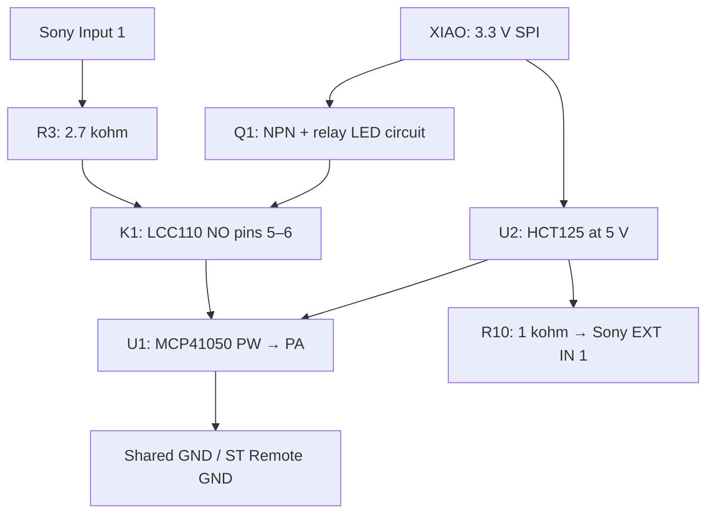

# Sony interface — through-hole prototype

Selected 2026-10-27; assembled and bench-tested through 2026-11-06. The user verified GPIO camera assertion/release, relay drive, and three output resistances. Controller v3 integrates gestures with this interface; physical testing of that build, Sony learning and power-transition acceptance remain pending. Supersedes the [AD8400 version](archive/sony-interface-ad8400.md) and earlier five-relay diagrams. Use the current pad map and learned-code table below.

## Complete prototype BOM

| Part | Required | Notes |
| --- | ---: | --- |
| MCP41050-I/P | 1 | 50 kohm, DIP-8; not MCP6002 |
| SN74HCT125N | 1 | DIP-14, TTL-compatible inputs; SPI translation and Camera 1 trigger |
| LCC110 | 1 | Already on hand; normally-open contact |
| 2N3904 TO-92 | 1 | Optical relay input driver; verify vendor pinout |
| 330 ohm, 1%, 0.25 W | 1 | Relay LED current |
| 1 kohm, 1%, 0.25 W | 2 | R2 NPN base; R10 inline camera pigtail |
| 2.7 kohm, 1%, 0.25 W | 1 | Sony-side series resistance |
| 47 kohm, 1%, 0.25 W | 6 | R4–R7 remote defaults; R8/R9 camera pull-downs |
| 100 nF ceramic, >=10 V | 2 | One at each powered IC |
| 10 uF, >=10 V electrolytic | 1 | Cable-entry bulk bypass; observe polarity |
| DIP-8 socket | 2, optional | Pot and LCC110 |
| DIP-14 socket | 1, optional | Buffer |
| Headers/housings, wire, insulation | As needed | Existing supplies first |
| Protoboard | Existing | Staged permanent assembly; no-cut fit requires dry-fit |

No SMD chip, adapter, soldering practice parts, extra SSR, flyback diode or additional power converter is needed for this version. Six discrete 47 kohm resistors are included in the current placement. The order includes spare components for future projects; see [ordered quantities](parts-sourcing.md).

## Signal and power

Sony Input 1 -> 2.7 kohm -> LCC110 normally-open contact -> pot PW -> pot PA -> shared ground. Input 2 insulated. Sony ST Remote GND joins XIAO ground. Relay isolates the signal when open; the whole assembly is not galvanically isolated.

Both powered ICs and relay LED driver use regulated 5 V from the XIAO USB/VBUS supply. Twist stays on 3V3. Never put vehicle 12 V on this circuit. Design supply target is 4.75–5.25 V at the interface under load.

## Circuit overview

The arrows show functional connections; the pin table below is the electrical wiring reference. Q1 controls the optocoupler LED, not the Sony signal. U2 translates CS, SCK and MOSI; its fourth channel generates the Camera 1 trigger. An open relay releases the command independently of the pot's stored code; software shutdown of the pot is not a substitute for opening the relay.

Reference designators: U1 pot, U2 buffer, K1 optical relay, Q1 transistor; R1 330 ohm LED resistor, R2 1 kohm base resistor, R3 2.7 kohm signal resistor; R4/R5/R6 47 kohm on CS/SCK/MOSI; R7 47 kohm base-to-ground; R8/R9 camera pull-downs; R10 1 kohm camera series resistor in cable; C1/C2 100 nF at U1/U2; C3 10 uF at power entry. [Point-to-point assembly and acceptance](assembly-and-test.md) expands the sequence.

## Physical pin wiring

| Part | Pins and nets |
| --- | --- |
| MCP41050 | 1 CS from buffer 3; 2 SCK from buffer 6; 3 SI from buffer 8; 4 GND; 5 PA to GND; 6 PW to LCC110 pin 6; 7 PB unconnected; 8 +5 V |
| HCT125 power | 14 +5 V; 7 GND |
| HCT125 channel 1 | 1 enable to GND; 2 input from D0/GPIO26 with 47 kohm to GND; 3 output to pot CS |
| HCT125 channel 2 | 4 enable to GND; 5 input from D8/GPIO2 with 47 kohm to GND; 6 output to pot SCK |
| HCT125 channel 3 | 10 enable to GND; 9 input from D10/GPIO3 with 47 kohm to GND; 8 output to pot SI |
| HCT125 camera channel | 13 enable GND; 12 input D2/GPIO28 with R8 47 kohm to GND; 11 output with R9 47 kohm to GND, then inline R10 1 kohm to EXT IN 1 |
| LCC110 control | +5 V through 330 ohm to pin 2; pin 3 to Q1 collector |
| LCC110 signal | Pin 5 to series 2.7 kohm/Sony Input 1; pin 6 to pot PW; pins 7/8 unused normally-closed contact; 1/4 package NC |
| Q1 | Emitter GND; base from D1/GPIO27 through 1 kohm; 47 kohm from base to GND |
| Bypass | 100 nF across pot 8/4; 100 nF across buffer 14/7; 10 uF across cable +5 V/GND |

Check actual notch/dot and transistor E/B/C assignment. Do not connect a buffer output to any XIAO pin. The HCT125 does not drive the relay LED: retain Q1.

## Harness

Fresh allocation; do not reuse old harnesses by contact number. In particular contact 2 carries 5 V.

| Contact | XIAO | GPIO | Purpose |
| --- | --- | ---: | --- |
| 1 | GND | — | Shared ground |
| 2 | 5V/VBUS | — | Interface supply |
| 3 | D8/SCK | 2 | Buffer clock input |
| 4 | D10/MOSI | 3 | Buffer data input |
| 5 | D0 | 26 | Buffer CS input |
| 6 | D1 | 27 | Relay driver enable |
| 7 | GND | — | Additional return |
| 8 | D2 | 28 | U2 channel 4 camera request |

Eight wires serve the complete remote-plus-camera design. D9/MISO remains unused. Twist wiring on D4/D5 is unchanged. Start with 100 kHz SPI and short cable; validate final cable and connector orientation before installation.

## Driver and calibration

Initialize relay enable LOW and CS HIGH before configuring outputs. While the relay is open, write MCP41050 command byte 0x11 followed by the calibrated 8-bit wiper value using SPI mode 0, MSB first. Wait initially 1 ms, enable relay 55 ms, then disable it at least 55 ms. Use nonblocking timers and clear queued commands on reset/fault; the controller backend includes a five-second watchdog. Only one command at a time. No chip readback or Sony acknowledgement is available.

Sony Custom learning allows our own separated codes. Use the table below instead of the historical external-controller resistance targets. Actual learning and recognition are still pending.

The relay input circuit is unchanged: about 10.5 mA nominal LED current from 5 V, with approximately 2.5 mA GPIO base drive. Allow 20 mA additional interface supply budget pending measurement. Use >=4 mA GPIO pad drive for the relay base signal. The HCT125's TTL inputs accept 3.3 V; its outputs meet the pot's 5 V logic requirement.

## Acceptance boundaries before installation

- **MCP41050 wiper current is limited to ±1 mA.** The fixed 2.7 kohm resistor alone does not guarantee that at every code or with an ideal 5 V source. Only enable codes meeting this limit with margin. The current learned-code candidates keep measured output resistance at or above 16.4 kohm, replacing the previous 4.4 kohm ATT candidate. Their estimated steady-state current is below the prototype 0.5 mA target; Sony learning is pending. See the code table below.
- All pot analog terminals must remain within GND and its actual VDD. Sony Input 1 measured approximately +3.3 V with an estimated 1.1–1.2 kohm source resistance from one load point; power transitions and all operating conditions remain uncharacterized.
- At steady reset/power-off the normally-open contact releases. Abrupt power loss remains unresolved until tested: optical release can take milliseconds while the pot supply falls sooner. A transient back-power path is possible. Use a simulated Sony source and scope/appropriate measurements before installation approval; revise sequencing if necessary. This BOM is for the bench prototype, not a claim that those transitions are solved.
- Calibrate with Sony physically disconnected; solderless duplication is optional. Resistance-mode measurements are only for the port with no external voltage applied. Energized simulated-input/Sony tests use voltage mode.
- Check continuity, rails, relay LED current, each commanded resistance, release/reset, cable behavior and power transitions. Then test actual receiver recognition at low volume. Firmware outputs remain disabled until validation; user performs flashing.

A [complete proposed ElectroCookie Mini pad allocation](../hardware/sony-remote/pad-map.md) and [all-component image](../hardware/sony-remote/placement-full.svg) are available; final physical acceptance is pending. The DIP packages occupy 4+7+4 pin rows, leaving little slack on a 17-row board; sockets, mounting clearance and wiring must be dry-fitted before permanent assembly. No larger board is being ordered speculatively. Camera controls are included: R8/R9 on board, R10 in the cable, using U2 channel 4.

## Sources

- [Microchip MCP41xxx datasheet](https://ww1.microchip.com/downloads/en/DeviceDoc/11195c.pdf): pinout, 50 kohm electrical limits and serial command format.
- [TI HCT125 datasheet](https://www.ti.com/lit/ds/symlink/sn74hct125.pdf): TTL inputs, pinout, unused inputs and bypassing.
- [LCC110 datasheet](https://www.littelfuse.com/assetdocs/littelfuse-integrated-circuits-lcc110-datasheet?assetguid=fef24721-9a57-4423-a6f7-7e12c72ec530).
- [2N3904 datasheet](https://www.onsemi.com/pdf/datasheet/2n3903-d.pdf).

## Calibration model and firmware contract

The assembled circuit grounds **PA, pin 5**, and leaves **PB, pin 7** open. Earlier documentation incorrectly interchanged the terminal names; the physical pin wiring stays unchanged. Microchip DS11195C Table 3-1 confirms these names. The matching estimate is `Rtotal ≈ R3 + Rcontact + Rwiper + (256 − code) × RAB / 256`: resistance decreases with increasing code, as observed.

The Sony learns the following five distinct candidate codes; do not assume its recognition windows until tested. Codes are fixed in `firmware/controller/sony_output.h`.

| Gesture / Sony learning assignment | Code | Output resistance |
| --- | ---: | --- |
| Positive turn / Volume + | 64 | 43.7 kohm measured |
| Negative turn / Volume - | 96 | about 36.9 kohm, interpolated |
| Single click / Mute | 128 | about 30 kohm measured |
| Held positive turn / Next Track | 160 | about 23.2 kohm, interpolated |
| Held negative turn / Prev Track | 192 | 16.4 kohm measured |

The end measurements imply about 54.6 kohm full pot resistance. At the measured minimum 16.4 kohm, a 3.3 V source would supply at most about 0.20 mA, ignoring its internal resistance. Even an ideal 5 V source would supply about 0.31 mA. These are steady-state estimates, not power-transition validation. No controller command writes outside the selected 64–192 range.

For Sony Custom assignment, use [knob-operated learning mode](gestures.md#knob-operated-learning--controller-v32): ten-second stationary hold toggles the mode, and each mapped gesture holds its code for three seconds rather than sending normal short pulses. Each learning hold releases automatically and ignores intervening gestures. The first 55 ms learning attempt did not register; longer-hold acceptance remains pending.

The implemented backend uses a bounded eight-step FIFO: relay open → program → settle at least 1 ms → assert 55 ms → release at least 55 ms. Each detent is one pulse. An event that cannot fit is rejected as a whole; queued commands older than 750 ms are discarded. Camera requests drive the separate GPIO and are unaffected by steering-pot changes. Reset, boot command, explicit release and detected Twist failures release both outputs and discard queued work. Standalone operation does not require a serial connection.

Controller v3 uses a five-second watchdog, 25 ms I2C timeouts and skips USB log records when transmit space is insufficient. These protect against normal scheduling stalls; physical pulse timing, fault and reset behavior remain bench acceptance items. The controller reports requests, never receiver acknowledgement.

At startup the CS buffer's pull-down holds CS low until the MCU drives it high. The relay remains off through R7. Preload output values before enabling GPIO directions, then establish CS high, SCK low and MOSI low. Program a known calibration value with the relay open before allowing pulses. A pot register write is exactly 16 clocks with CS low, command 0x11 followed by one code byte, then CS high. No MISO connection or readback exists.

The current firmware does not measure interface supply, Sony voltage, or relay state. Software cannot presently detect a disconnected interface or prove a command was accepted. Release-on-fault applies to faults it can observe; power sequencing and a hung controller require hardware validation and watchdog testing.

## Required Camera 1 extension

See [camera circuit and acceptance](camera-control.md). R8/R9 add two 47 kohm board resistors; R10 is one 1 kohm inline camera-cable resistor. No additional IC or transistor. Use revised pad map; old unused-channel ties must be removed.

## Receiver measurements

See [2026-10-28 bench report](bench-results-2026-10-28.md) for raw readings, assumptions, derived command currents and remaining tests. Sony powered successfully; resistor sensing was characterized at one load point. No steering command has been learned or validated yet. See also the [assembled-board results](bench-results-2026-11-05.md).

## Observed learning functions

The actual receiver offers Prev Track, Play/Pause, Next Track, Source, Mute, Volume -, Volume +, Voice, Answer Call and Hang Up; see [user observation](bench-results-2026-10-28.md#user-observed-steering-remote-learning-options). The five mapped functions use the current learned-code table. The old external-controller Mute/ATT resistance is superseded. Camera control remains a separate EXT IN 1 output. No resistance values for the additional functions are established by this menu observation.
