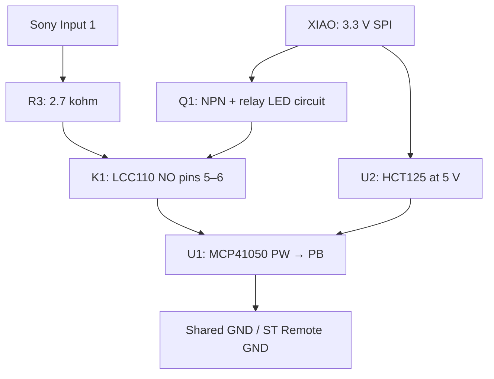

# Sony interface — through-hole prototype

Selected 2026-10-27: MCP41050-I/P, SN74HCT125N and one existing LCC110. Parts ordered from DigiKey, confirmed by the user on 2026-10-27. Prototype only: not assembled or electrically validated; no Sony-output firmware implemented or enabled. Supersedes the [AD8400 version](archive/sony-interface-ad8400.md) and previous five-relay diagrams. Do not use earlier pin maps or calibrated codes.

## Complete prototype BOM

| Part | Required | Notes |
| --- | ---: | --- |
| MCP41050-I/P | 1 | 50 kohm, DIP-8; not MCP6002 |
| SN74HCT125N | 1 | DIP-14, TTL-compatible inputs; SPI translation only |
| LCC110 | 1 | Already on hand; normally-open contact |
| 2N3904 TO-92 | 1 | Optical relay input driver; verify vendor pinout |
| 330 ohm, 1%, 0.25 W | 1 | Relay LED current |
| 1 kohm, 1%, 0.25 W | 1 | NPN base current |
| 2.7 kohm, 1%, 0.25 W | 1 | Sony-side series resistance |
| 47 kohm, 1–5%, 0.25 W | 4 | Three buffer-input pull-downs and NPN base pull-down |
| 100 nF ceramic, >=10 V | 2 | One at each powered IC |
| 10 uF, >=10 V electrolytic | 1 | Cable-entry bulk bypass; observe polarity |
| DIP-8 socket | 2, optional | Pot and LCC110 |
| DIP-14 socket | 1, optional | Buffer |
| Headers/housings, wire, insulation | As needed | Existing supplies first |
| Protoboard | Existing | Breadboard first; permanent no-cut board fit pending |

No SMD chip, adapter, soldering practice parts, extra SSR, flyback diode or additional power converter is needed for this version. Four discrete 47 kohm resistors are simplest to source; a four-element bussed 47 kohm network is optional. The order includes spare components for future projects; see [ordered quantities](parts-sourcing.md).

## Signal and power

Sony Input 1 -> 2.7 kohm -> LCC110 normally-open contact -> pot PW -> pot PB -> shared ground. Input 2 insulated. Sony ST Remote GND joins XIAO ground. Relay isolates the signal when open; the whole assembly is not galvanically isolated.

Both powered ICs and relay LED driver use regulated 5 V from the XIAO USB/VBUS supply. Twist stays on 3V3. Never put vehicle 12 V on this circuit. Design supply target is 4.75–5.25 V at the interface under load.

## Circuit overview

The arrows show functional connections; the pin table below is the electrical wiring reference. Q1 controls the optocoupler LED, not the Sony signal. U2 translates CS, SCK and MOSI only. An open relay releases the command independently of the pot's stored code; software shutdown of the pot is not a substitute for opening the relay.

Reference designators: U1 pot, U2 buffer, K1 optical relay, Q1 transistor; R1 330 ohm LED resistor, R2 1 kohm base resistor, R3 2.7 kohm signal resistor; R4/R5/R6 47 kohm on CS/SCK/MOSI; R7 47 kohm base-to-ground; C1/C2 100 nF at U1/U2; C3 10 uF at power entry. [Point-to-point assembly and acceptance](assembly-and-test.md) expands the sequence.

## Physical pin wiring

| Part | Pins and nets |
| --- | --- |
| MCP41050 | 1 CS from buffer 3; 2 SCK from buffer 6; 3 SI from buffer 8; 4 GND; 5 PB to GND; 6 PW to LCC110 pin 6; 7 PA unconnected; 8 +5 V |
| HCT125 power | 14 +5 V; 7 GND |
| HCT125 channel 1 | 1 enable to GND; 2 input from D0/GPIO26 with 47 kohm to GND; 3 output to pot CS |
| HCT125 channel 2 | 4 enable to GND; 5 input from D8/GPIO2 with 47 kohm to GND; 6 output to pot SCK |
| HCT125 channel 3 | 10 enable to GND; 9 input from D10/GPIO3 with 47 kohm to GND; 8 output to pot SI |
| HCT125 unused channel | 13 enable to +5 V; 12 input to GND; 11 output unconnected |
| LCC110 control | +5 V through 330 ohm to pin 2; pin 3 to Q1 collector |
| LCC110 signal | Pin 5 to series 2.7 kohm/Sony Input 1; pin 6 to pot PW; pins 7/8 unused normally-closed contact; 1/4 package NC |
| Q1 | Emitter GND; base from D1/GPIO27 through 1 kohm; 47 kohm from base to GND |
| Bypass | 100 nF across pot 8/4; 100 nF across buffer 14/7; 10 uF across cable +5 V/GND |

Check actual notch/dot and transistor E/B/C assignment. Do not connect a buffer output to any XIAO pin. The HCT125 does not drive the relay LED: retain Q1.

## Harness

Fresh allocation; do not reuse old harnesses by contact number. In particular contact 2 carries 5 V.

| Contact | XIAO | GPIO | Purpose |
| --- | --- | ---: | --- |
| 1 | GND | — | Shared ground |
| 2 | 5V/VBUS | — | Interface supply |
| 3 | D8/SCK | 2 | Buffer clock input |
| 4 | D10/MOSI | 3 | Buffer data input |
| 5 | D0 | 26 | Buffer CS input |
| 6 | D1 | 27 | Relay driver enable |
| 7, optional | GND | — | Additional return |
| 8, optional | Unconnected | — | Future camera-control reserve |

Six wires suffice. D9/MISO remains unused. Twist wiring on D4/D5 is unchanged. Start with 100 kHz SPI and short cable; validate final cable and connector orientation before installation.

## Driver and calibration

Initialize relay enable LOW and CS HIGH before configuring outputs. While the relay is open, write MCP41050 command byte 0x11 followed by the calibrated 8-bit wiper value using SPI mode 0, MSB first. Wait initially 1 ms, enable relay 55 ms, then disable it at least 55 ms. Use nonblocking timers and clear queued commands on reset/fault; add a watchdog in the future hardware backend. Only one command at a time. No chip readback or Sony acknowledgement is available.

Calibrate total resistances, including the fixed resistor, contact and wiper: mute 4.4 kohm, next 8.8 kohm, previous 12.1 kohm, volume up 16.8 kohm, volume down 23.6 kohm. MCP41050 wiper resistance differs from AD8400 and its full resistance tolerance is ±30%; do not reuse old nominal codes as calibrated values.

The relay input circuit is unchanged: about 10.5 mA nominal LED current from 5 V, with approximately 2.5 mA GPIO base drive. Allow 20 mA additional interface supply budget pending measurement. Use >=4 mA GPIO pad drive for the relay base signal. The HCT125's TTL inputs accept 3.3 V; its outputs meet the pot's 5 V logic requirement.

## Acceptance boundaries before installation

- **MCP41050 wiper current is limited to ±1 mA.** The fixed 2.7 kohm resistor alone does not guarantee that at every code or with an ideal 5 V source. Measure the Sony's source impedance/loaded current. Only enable calibrated commands meeting this limit, with margin; target <=0.5 mA for the first prototype. Use a simulated 5 V source through 10 kohm initially.
- All pot analog terminals must remain within GND and its actual VDD. Sony voltage is expected to be low-voltage sensing but remains unmeasured for this receiver.
- At steady reset/power-off the normally-open contact releases. Abrupt power loss remains unresolved until tested: optical release can take milliseconds while the pot supply falls sooner. A transient back-power path is possible. Use a simulated Sony source and scope/appropriate measurements before installation approval; revise sequencing if necessary. This BOM is for the bench prototype, not a claim that those transitions are solved.
- Breadboard and calibrate with Sony physically disconnected. Resistance-mode measurements are only for the port with no external voltage applied. Energized simulated-input/Sony tests use voltage mode.
- Check continuity, rails, relay LED current, each commanded resistance, release/reset, cable behavior and power transitions. Then test actual receiver recognition at low volume. Firmware outputs remain disabled until validation; user performs flashing.

A [complete proposed ElectroCookie Mini pad allocation](../hardware/sony-remote/pad-map.md) and [all-component image](../hardware/sony-remote/placement-full.svg) are available; final physical acceptance is pending. The DIP packages occupy 4+7+4 pin rows, leaving little slack on a 17-row board; sockets, mounting clearance and wiring must be dry-fitted before permanent assembly. No larger board is being ordered speculatively. Camera controls are outside this BOM.

## Sources

- [Microchip MCP41xxx datasheet](https://ww1.microchip.com/downloads/en/DeviceDoc/11195c.pdf): pinout, 50 kohm electrical limits and serial command format.
- [TI HCT125 datasheet](https://www.ti.com/lit/ds/symlink/sn74hct125.pdf): TTL inputs, pinout, unused inputs and bypassing.
- [LCC110 datasheet](https://www.littelfuse.com/assetdocs/littelfuse-integrated-circuits-lcc110-datasheet?assetguid=fef24721-9a57-4423-a6f7-7e12c72ec530).
- [2N3904 datasheet](https://www.onsemi.com/pdf/datasheet/2n3903-d.pdf).

## Calibration model and firmware contract

For an initial estimate only, `Rtotal ≈ R3 + Rcontact + Rwiper + code × RAB / 256`. Code 0 is near PB, not an open circuit; power-up code is midscale. The 50 kohm value is nominal. For a first estimate taking Rcontact = 23 ohm and Rwiper = 125 ohm, codes are approximately:

| Intention | Target total | Initial estimate only |
| --- | ---: | ---: |
| Mute/ATT | 4,400 ohm | 8 |
| Next track | 8,800 ohm | 30 |
| Previous track | 12,100 ohm | 47 |
| Volume up | 16,800 ohm | 71 |
| Volume down | 23,600 ohm | 106 |

These are calculations, not measured settings or released firmware constants. Measure the assembled output and select the nearest achievable safe code. Record actual total resistance and receiver acceptance; Sony acceptance windows are unknown. Do not scan arbitrary codes while connected to the receiver.

The future backend must accept one intention plus a positive step count from the existing gesture engine. It must split steps into bounded pulses, reject uncalibrated commands, and drop stale work on disconnect/fault rather than replaying a backlog. Camera intentions stay separate. Suggested state progression is RELEASED → PROGRAM → SETTLE → ASSERT → RELEASE GAP → RELEASED. Any error returns to relay-off; a watchdog must address a stalled MCU. None of this backend exists yet.

At startup the CS buffer's pull-down holds CS low until the MCU drives it high. The relay remains off through R7. Preload output values before enabling GPIO directions, then establish CS high, SCK low and MOSI low. Program a known calibration value with the relay open before allowing pulses. A pot register write is exactly 16 clocks with CS low, command 0x11 followed by one code byte, then CS high. No MISO connection or readback exists.

The current firmware does not measure interface supply, Sony voltage, or relay state. Software cannot presently detect a disconnected interface or prove a command was accepted. Release-on-fault applies to faults it can observe; power sequencing and a hung controller require hardware validation and future watchdog work.
