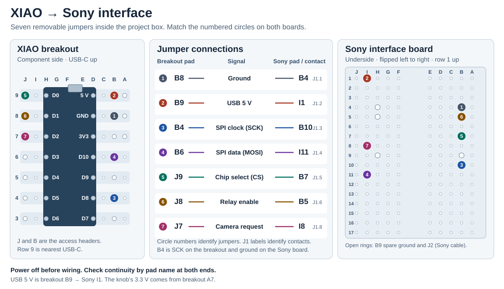
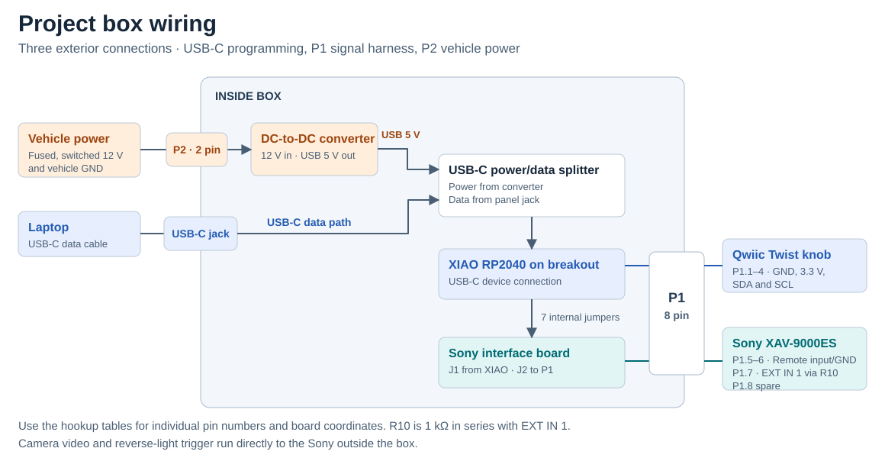
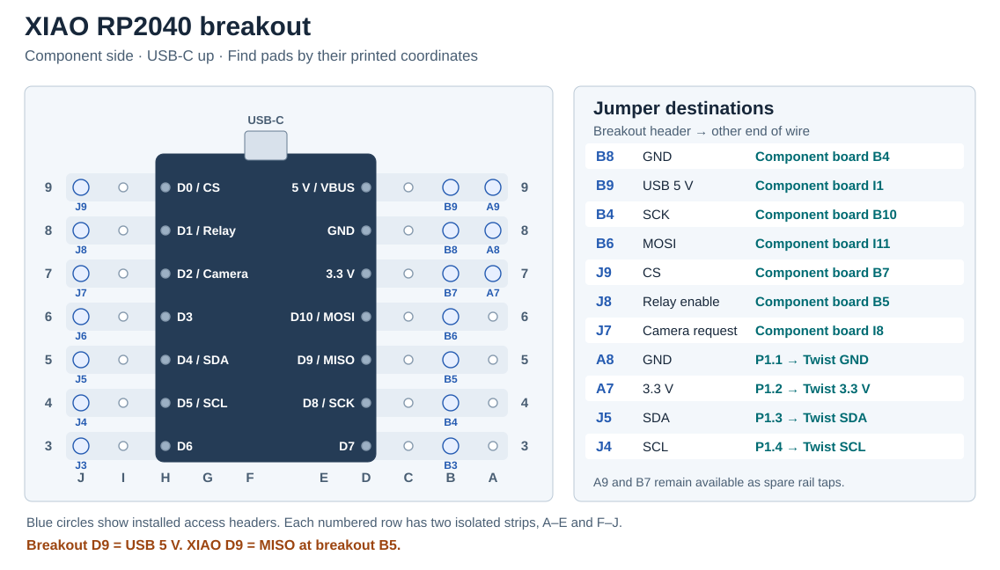

# Project box hookup

The XIAO RP2040 and its breakout, Sony interface board, DC-to-DC converter, and USB-C power/data splitter all sit inside the box. The exterior connections are one 8-pin knob/Sony harness, one 2-pin vehicle power connector, and the USB-C programming jack.

## Internal jumper wires

Connect the seven jumpers shown above before wiring [P1](#8-pin-box-harness-p1) and [P2](#2-pin-power-connector-p2-and-usb-c-programming). The XIAO breakout is shown from the component side. The Sony board is shown from the header side, with columns mirrored horizontally and the same printed pad IDs. See the [component placement](../hardware/sony-remote/placement-full.svg) and [pad map](../hardware/sony-remote/pad-map.md) for assembly details.

| XIAO breakout header | Signal | Component-board contact and pad |
| --- | --- | --- |
| B8 | Shared GND | J1.1 at **B4** |
| B9 | USB 5 V / VBUS | J1.2 at **I1** |
| B4 | XIAO D8 / SCK | J1.3 at **B10** |
| B6 | XIAO D10 / MOSI | J1.4 at **I11** |
| J9 | XIAO D0 / CS | J1.5 at **B7** |
| J8 | XIAO D1 / relay enable | J1.6 at **B5** |
| J7 | XIAO D2 / camera request | J1.8 at **I8** |

Component-board J1.7 at B9 is the redundant ground header left unused in the working bench setup. Breakout A8 supplies the knob's ground independently of the B8-to-B4 jumper, so the previous ground Y splice is unnecessary. Breakout B7 and A9 are spare rail access points in this allocation.

## 8-pin box harness (P1)

Use the cavity numbers molded into the chosen keyed connector. This table assigns signals to those numbers and works for either a panel connector or an inline plug on a box pigtail. Confirm the mating cavity numbers before crimping. **P1 is the external 8-pin connector. J1 is the internal component-board wiring.**

| P1 cavity | Inside the box | Outside the box |
| --- | --- | --- |
| 1 | XIAO breakout **A8** | Twist GND |
| 2 | XIAO breakout **A7** | Twist 3.3 V |
| 3 | XIAO breakout **J5** | Twist SDA |
| 4 | XIAO breakout **J4** | Twist SCL |
| 5 | Component board **H5** (J2.1) | Sony Steering Remote **Input 1** |
| 6 | Component board **H4** (J2.2) | Sony **ST Remote GND** |
| 7 | Component board **H9** (J2.3) | Sony **EXT IN 1**, through one inline **R10, 1 kΩ** |
| 8 | Spare | Spare |

Split the vehicle-side P1 cable into the four-wire Twist branch and the three-wire Sony branch. The Twist uses 3.3 V, including its LED. Its INT and RST remain open. Keep the Sony ground on its own P1 pin even though it shares logic ground inside the box. Insulate the Sony steering adapter's unused Input 2. Leave the existing sleeved R10 in series anywhere along the H9-to-EXT IN 1 path.

## 2-pin power connector (P2) and USB-C programming

| P2 cavity | Vehicle side | Box side |
| --- | --- | --- |
| 1 | Fused, switched 12 V | Converter input positive |
| 2 | Vehicle ground | Converter input negative |

Connect the converter's regulated USB-C output to the splitter's **power** input. The splitter's device connection goes to the XIAO USB-C port. The panel USB-C jack feeds the splitter's **data** input for programming. The XIAO breakout supplies VBUS to the component board and 3.3 V to the Twist.

The converter/splitter/XIAO arrangement passed programming on the bench. The final panel-to-splitter connection still needs to be verified. Retain the working USB-C data path, including its CC attachment, when adding the panel connection. Keep laptop VBUS separate from the converter's 5 V output. With the converter on, check that the XIAO enumerates through the panel jack with the external plug in both orientations. Keep access to XIAO BOOT and RESET for recovery.

## Before connecting the Sony

1. With power disconnected, verify each breakout header against the XIAO pad on the same strip. Check that the A–E and F–J strips are independent and the 5 V, 3.3 V and GND rails are distinct.
2. Check each jumper and each P1/P2 cavity end to end. In particular, confirm breakout **B4 → component-board B10** (SCK) and breakout **B8 → component-board B4** (GND). They use different coordinates on each board.
3. Power the box with the Sony and knob disconnected. Check about 5 V at component-board I1 relative to B4 and about 3.3 V at P1.2 relative to P1.1.
4. Connect the Twist and verify enumeration and knob input through the programming jack. Use the [assembly and acceptance checks](assembly-and-test.md) for receiver connection and power sequencing.

## Camera and vehicle wiring outside the box

| Mode | Sony video input | Trigger | Overlay |
| --- | --- | --- | --- |
| Actual reverse | REAR CAMERA IN | Reverse-light signal directly to Sony REVERSE IN | Sony parking lines |
| Manual preview | CAMERA IN 1 | Box P1.7 to Sony EXT IN 1 | No lines |

The camera feed splits directly to the Sony inputs using the bench-tested RCA Y. Camera power is separate from the box, with switched power available during manual preview. See [camera control](camera-control.md) for the trigger circuit, reverse priority and acceptance checks.

## XIAO breakout pin map

View the **component side with the XIAO USB-C end at the top**. Row 9 is nearest USB-C. Use the printed letters and numbers to locate each pad. Each numbered row has two independent copper strips, A–E and F–J. The XIAO is mounted in columns D and H. The main access headers are B3–B9 and J3–J9. A7–A9 duplicate the three power rails for separate leads.

| Row | Breakout D pad and B header | Extra A header | Breakout H pad and J header |
| --- | --- | --- | --- |
| 9 | D9 / B9 = 5 V / VBUS | A9 = 5 V / VBUS | H9 / J9 = XIAO D0 / CS (GPIO26) |
| 8 | D8 / B8 = GND | A8 = GND | H8 / J8 = XIAO D1 / relay enable (GPIO27) |
| 7 | D7 / B7 = 3.3 V | A7 = 3.3 V | H7 / J7 = XIAO D2 / camera request (GPIO28) |
| 6 | D6 / B6 = XIAO D10 / MOSI (GPIO3) | — | H6 / J6 = XIAO D3 (GPIO29) |
| 5 | D5 / B5 = XIAO D9 / MISO (GPIO4) | — | H5 / J5 = XIAO D4 / SDA (GPIO6) |
| 4 | D4 / B4 = XIAO D8 / SCK (GPIO2) | — | H4 / J4 = XIAO D5 / SCL (GPIO7) |
| 3 | D3 / B3 = XIAO D7 / RX (GPIO1) | — | H3 / J3 = XIAO D6 / TX (GPIO0) |

**Breakout D9 is 5 V. XIAO D9 is the unused MISO signal at breakout B5.** Use the board names in the hookup tables to distinguish repeated coordinates.
