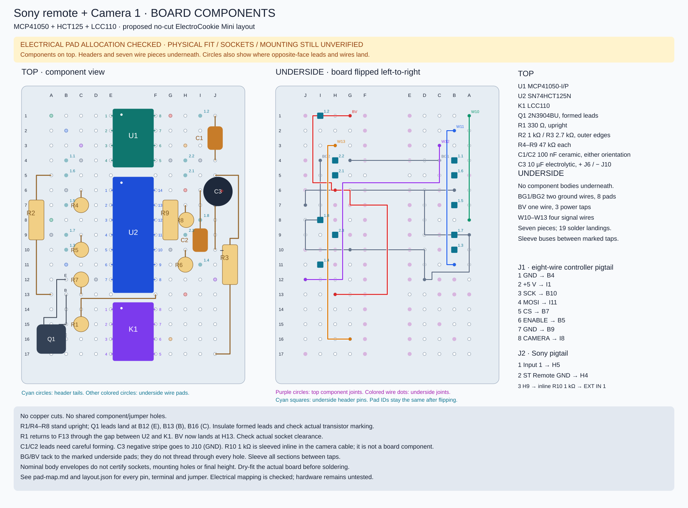

# Current Sony interface hardware

The assembled board uses **MCP41050-I/P + SN74HCT125N + LCC110 + 2N3904**, with through-hole parts and shared logic/Sony ground. The [bench record](../../docs/bench-results-2026-11-05.md) lists verified results and pending acceptance checks.

- [Internal jumper image](../internal-jumpers.svg) and [project box hookup](../../docs/wiring.md)
- [Circuit pin table](../../docs/sony-interface.md#physical-pin-wiring) and [assembly and acceptance](../../docs/assembly-and-test.md)
- [BOM](bom.csv) and [ordered parts](../../docs/parts-sourcing.md)
- [Complete pad map](pad-map.md) and [checked layout model](layout.json)

## Complete proposed placement

All 16 component bodies are on top. The 12 insulated underside jumpers have 24 distinct landings. The underside view mirrors columns while retaining the physical pad IDs. The SVG marks topside header joints in cyan and underside component joints in purple.

Install the header pins from underneath and solder their tails from the top. Use separate pins at spaced pads and a two-pin header at H4–H5. Use the [pad map](pad-map.md) for endpoints and formed-lead details. Check socket clearance, mounting and lead lengths against the actual parts.

Generate with `python3 scripts/full-placement.py`; verify with `python3 scripts/full-placement.py --check`. The full host suite includes current-layout fault injection. The older `scripts/placement-study.py` still reproduces the IC-only image, but the all-component image above is the current placement proposal.

## Camera output

HCT125 channel 4 drives Camera 1 through R10, a sleeved 1 kohm resistor inline in the J2.3 cable. Check [camera electrical acceptance](../../docs/camera-control.md) before connecting Sony.

The [earlier IC-only fit study](placement.svg) is a subset of this layout. The [five-PhotoMOS archive](../archive/sony-remote-photomos/README.md) documents a superseded circuit.
