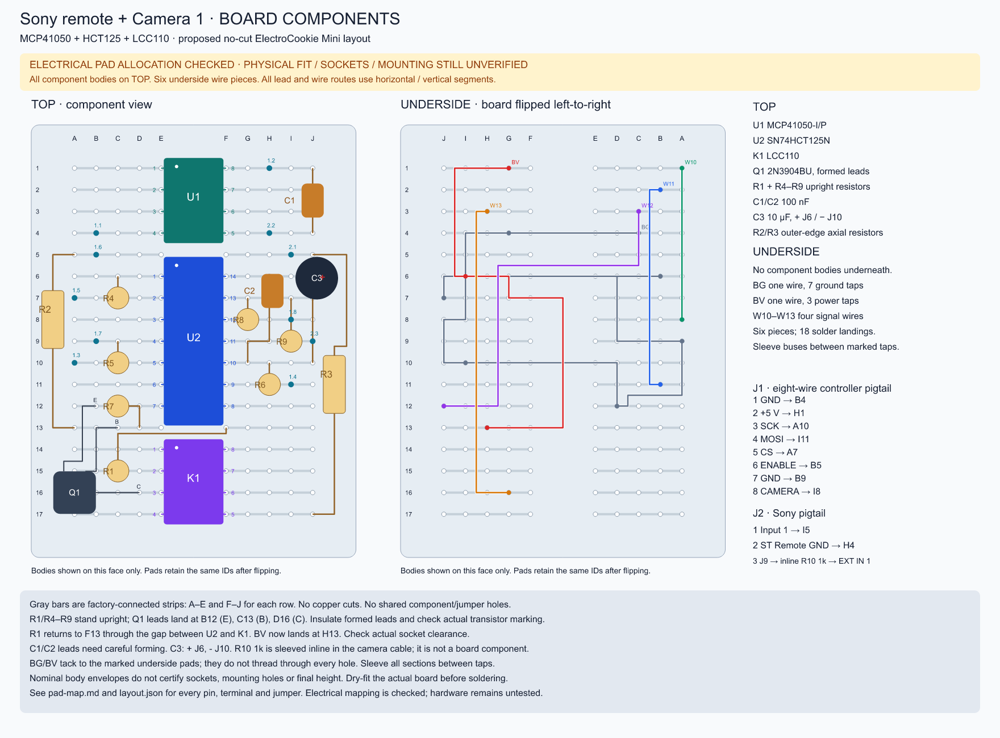

# Current Sony interface hardware

Selected: **MCP41050-I/P + SN74HCT125N + LCC110 + 2N3904**, all through-hole, shared logic/Sony ground. Parts ordered; not physically validated.

- [Circuit and complete pin-level connections](../../docs/sony-interface.md)
- [Assembly, calibration and acceptance](../../docs/assembly-and-test.md)
- [Harness and controller pins](../../docs/wiring.md)
- [Exact purchased parts and spare quantities](../../docs/parts-sourcing.md)
- [Per-controller BOM](bom.csv)
- [All-component placement SVG](placement-full.svg) / [PNG preview](placement-full.png) — top and mirrored underside
- [Complete pad / jumper table](pad-map.md) and [checked layout model](layout.json)
- [Earlier IC-only fit study](placement.svg) — subset reference

The current all-component candidate places all 16 board component references, all eleven pigtail landings and six underside wire pieces (two tapped buses and four signal wires) without copper cuts or shared holes. The checker verifies connectivity against the current circuit and nominal same-face body separation. Physical fit, actual sockets, mounting holes, lead forming and height remain unverified. This is a complete proposed electrical pad map, not a physically accepted assembly.

The former five-PhotoMOS JSON/SVG/BOM files are in [hardware/archive](../archive/sony-remote-photomos/README.md). Their generator and tests are retained for history and do not validate this circuit. Never build the current circuit using those drawings or connector allocations.

## Complete proposed placement

All 16 board component bodies are now on top: R1 and the six 47 kohm resistors stand upright; R2/R3 lie along the outer edges. The underside contains only two tapped buses, four signal wires and solder joints. All component-lead and wire routes use horizontal/vertical segments. The drawing renderer and model checker reject diagonal segments. Wire pieces remain six and wire solder landings remain 18. The backside view is mirrored horizontally while retaining physical pad IDs.

BG is one seven-tap ground bus; BV is one three-tap 5 V bus. Sleeve the wire between marked solder taps; intermediate taps tack onto underside pads. This is fewer cut/strip pieces, not fewer logical nets. If continuous tapped wires prove awkward, equivalent separate segments are still an option. R1 now stands at C15, with its sleeved return routed through the U2/K1 gap to F13. The power-bus tap moves to H13. Q1 moves toward the lower-left corner, its emitter lands at B12, and R7 shifts to C12/D13. These are changed physical pad assignments: use the current table, not a previous image. Check socket clearance and untrimmed lead lengths before soldering; use an insulated extension if an actual lead cannot reach safely. Extended resistor leads must be sleeved.

The pigtail wires land on separate pads. Connector housings stay off-board; no in-line header footprint is implied. Q1 requires formed leads and the ceramic capacitors require lead spreading. Socket/mounting interference and actual lead lengths must be dry-fitted before soldering. See [the pad map](pad-map.md) for every endpoint and assembly conditions.

Generate with `python3 scripts/full-placement.py`; verify with `python3 scripts/full-placement.py --check`. The full host suite includes current-layout fault injection. The older `scripts/placement-study.py` still reproduces the IC-only image, but the all-component image above is the current placement proposal.

## Camera included

The updated map uses HCT125 channel 4 for Camera 1. R8/R9 are on-board; R10 1 kohm is sleeved inline in the J2.3 camera cable. No second LCC110, Q2 or larger board. J1.2 now H1; C2 ground G10; C3 +J6/-J10; BV no longer taps G7. Consult [camera electrical acceptance](../../docs/camera-control.md) before Sony connection. The geometry checker excludes off-board R10 and actual socket/lead height.
