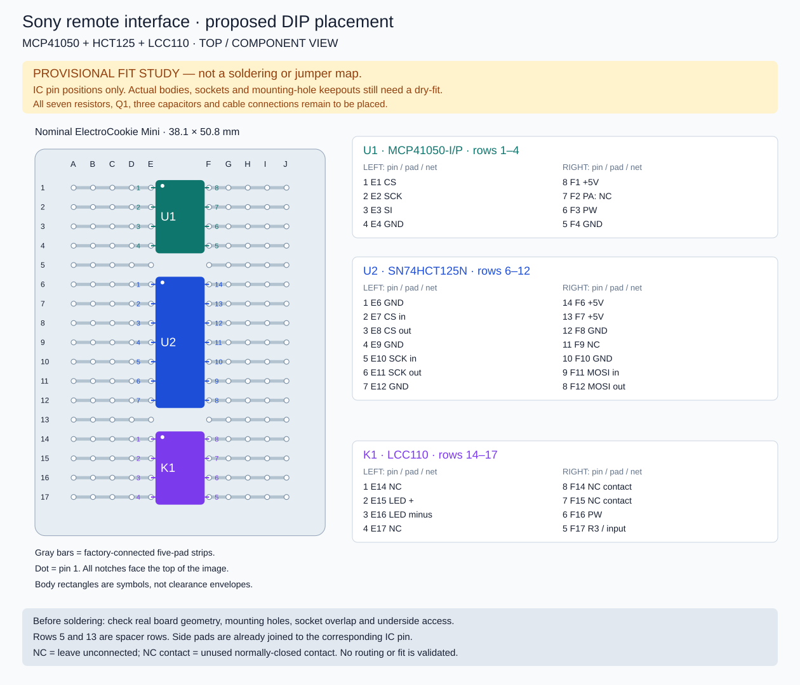

# Current Sony interface hardware

Selected: **MCP41050-I/P + SN74HCT125N + LCC110 + 2N3904**, all through-hole, shared logic/Sony ground. Parts ordered; not physically validated.

- [Circuit and complete pin-level connections](../../docs/sony-interface.md)
- [Assembly, calibration and acceptance](../../docs/assembly-and-test.md)
- [Harness and controller pins](../../docs/wiring.md)
- [Exact purchased parts and spare quantities](../../docs/parts-sourcing.md)
- [Per-controller BOM](bom.csv)
- [Proposed current-design placement image](placement.svg) — IC pin fit study only

The circuit guide contains the current functional diagram and electrical pin map. A verified permanent pad placement does not exist yet: dry-fit the actual DIP packages, sockets, passives and connectors on the no-cut ElectroCookie Mini before creating one. Do not mistake a functional diagram for a physical pad layout.

The former five-PhotoMOS JSON/SVG/BOM files are in [hardware/archive](../archive/sony-remote-photomos/README.md). Their generator and tests are retained for history and do not validate this circuit. Never build the current circuit using those drawings or connector allocations.

## Proposed placement image

Candidate top-view pins: U1 at E/F rows 1–4, U2 at E/F rows 6–12, K1 at E/F rows 14–17. Pin-1 marks face the top. These positions are a proposed pin allocation, not proof of fit. The diagram identifies every IC pin and net. Body rectangles are illustrative, not measured package/socket outlines. Mounting-hole keepouts remain unmeasured.

Q1, all seven resistors, three capacitors, harness terminations, jumpers and solder-side routing remain unplaced. Side pads share their IC leg's factory-connected strip and are not independent extra nets. Do not solder from this study.

Regenerate with `python3 scripts/placement-study.py`; verify reproducibility with `python3 scripts/placement-study.py --check`. Neither operation verifies electrical connectivity or mechanical fit. Use the circuit guide as the electrical reference.
